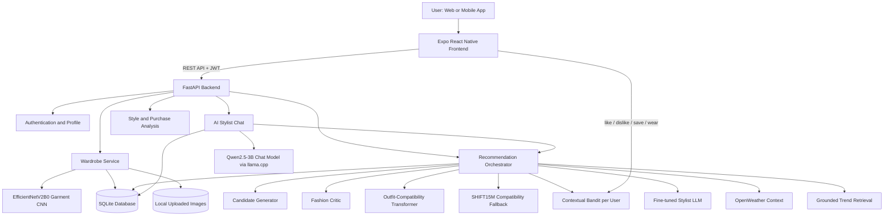

# AURA: Agentic Personalised Wardrobe Stylist

## Project Report

## 1. Abstract

AURA is a full-stack, fashion-aware wardrobe recommendation system. It allows a user to upload photographs of clothes they already own, automatically analyses those garments, stores them in a digital wardrobe, and recommends complete outfits for an occasion and weather context. Unlike a shopping-only recommender, AURA prioritises the user's owned garments and learns from their saves, likes, skips, ratings, and wear history.

The system combines trained models, an online-learning ranker and local language models in an inspectable agentic pipeline:

1. An EfficientNetV2B0 multi-task CNN classifies uploaded garment images and produces a 512-d visual embedding.
2. An outfit-compatibility transformer trained on Polyvore Outfits scores how well an outfit's pieces go together from those embeddings (a SHIFT15M category-pair model remains as a fallback).
3. A bounded agentic ranker builds only complete outfits from owned garments and scores them with colour, occasion, weather, preference, feedback, novelty and trend signals plus learned compatibility.
4. A per-user contextual bandit (Thompson sampling) personalises that ranking online from each user's likes, dislikes, saves, wears and skips.
5. A fine-tuned stylist LLM (Qwen2.5-1.5B + LoRA) chooses the best of the top five outfits, on the Stylist screen and in chat.
6. A local instruction model (Qwen2.5-3B) holds the chat conversation, grounded in the user's wardrobe and the chosen outfit, without replacing the ownership and completeness checks.

AURA is best described as a fashion-aware, personalised recommendation prototype. Its scores are ranking signals, not calibrated probabilities or guarantees of human stylist agreement.

## 2. Problem Statement

People frequently own many clothes but still find it difficult to decide what to wear. Existing fashion systems often recommend products to buy instead of helping users combine clothes already present in their wardrobe. They can also ignore weather, occasion, individual preferences, repeated usage, and recent trends.

AURA addresses this problem by answering:

- What can the user wear from clothes they already own?
- Do the selected garments form a complete and compatible outfit?
- Is the outfit appropriate for the occasion and weather?
- Does it match the user's explicit and learned preferences?
- Has the user worn the same pieces too recently?
- Which wardrobe gaps are worth filling through a future purchase?

## 3. Objectives

- Build a searchable digital wardrobe from user-uploaded images.
- Automatically recognise garment type, garment group, and colour.
- Generate only structurally complete outfits from owned and available garments.
- Rank outfits using fashion compatibility and contextual rules.
- personalise results using profile preferences and behavioural feedback.
- Provide explainable recommendations and an AI fashion chat interface.
- Analyse wardrobe balance and identify useful future purchases.
- Keep agent execution bounded, inspectable, and safe.

## 4. High-Level Architecture



### Architectural Layers

| Layer | Responsibility |
|---|---|
| Presentation | Expo/React Native interface for web and mobile |
| API | FastAPI endpoints, validation, authentication, and static image serving |
| Domain services | Wardrobe, recommendations, chat, trends, weather, style analysis, and purchase impact |
| Agentic orchestration | Bounded sequence of retrieval, generation, critique, scoring, memory, and ranking |
| Machine learning | H&M garment CNN, Polyvore outfit-compatibility transformer, SHIFT15M fallback, per-user contextual bandit, fine-tuned stylist LLM, local chat LLM |
| Persistence | SQLite records, ranked recommendation runs, and local uploaded image/model artifacts |
| External intelligence | Optional OpenWeather; local fashion trend cache |

## 5. Technology Stack

### Frontend

- Expo 57
- React Native 0.86
- React 19
- TypeScript 6
- React Navigation
- Zustand for client state
- TanStack Query for server state and caching
- Axios for API communication
- NativeWind/Tailwind styling
- Expo Image, Image Picker, and Secure Store
- React Native Reanimated

### Backend

- Python
- FastAPI and Uvicorn
- Pydantic request/response validation
- SQLite database
- TensorFlow/Keras
- NumPy and Pillow image processing
- JWT-based authentication and password hashing
- LangGraph-style agent orchestration concepts
- OpenWeather integration
- Local language models through llama.cpp: fine-tuned stylist GGUF (outfit choice) and Qwen2.5-3B GGUF (chat)
- NumPy Bayesian linear model for the per-user contextual bandit
- Locally cached, curated trend context (no hosted LLM/search generation)
- Explicit recommendation impressions and validated user-feedback evaluation
- Pytest for backend tests

## 6. Main User Features

1. Account signup and login.
2. User onboarding for style preferences, body/sizing information, and skin tone.
3. Uploading clothing photographs into a personal wardrobe.
4. Automatic CNN analysis of garment type, group, and colour.
5. Manual category correction when the CNN prediction is wrong.
6. Wardrobe search, filtering, viewing, and deletion.
7. Occasion- and weather-aware outfit recommendations.
8. Recommendation cards showing every uploaded garment of the outfit together.
9. Save, like, skip, rate, and “wear today” feedback on the Stylist screen, and Like / Not for me / Wore it under chat outfits; every reaction immediately updates the user's personal ranking model.
10. AI stylist chat that recommends outfits for an occasion from the user's wardrobe, shows them, and answers styling questions.
11. Separate chat sessions, recent context, and persistent chat history.
12. Style analysis and wardrobe-gap detection.
13. Purchase-impact analysis for deciding whether a new item adds value.
14. Profile, appearance, and activity-history screens.

The removed avatar/virtual try-on prototype is not part of the current system.

## 7. End-to-End Workflow

### 7.1 Garment Upload

1. The authenticated user selects an image.
2. The frontend sends a multipart upload request to FastAPI.
3. The backend validates file type and size and stores the image.
4. The image is resized to `224 × 224 × 3` and passed to the fashion CNN.
5. The model produces three probability distributions: product type, garment group, and colour group.
6. The predicted labels and confidence information are stored with the wardrobe item.
7. The user can correct its broad wardrobe category.

### 7.2 Outfit Recommendation

1. Retrieve only the authenticated user's available wardrobe items.
2. Generate structurally complete outfit candidates.
3. Retrieve optional weather, trend, profile, feedback, and wear-history context.
4. Reject candidates that are incomplete, unowned, or clearly unsuitable.
5. Calculate rule-based component scores.
6. Apply the outfit-compatibility transformer to the pieces' CNN embeddings (SHIFT15M category-pair model as fallback).
7. Rank candidates: by the hand-tuned prior for a user without feedback, otherwise by a Thompson sample from that user's contextual bandit (Section 12.11), followed by a diversity rerank.
8. If the fine-tuned stylist LLM is installed, it may move one of the top five options to first place by option number; it never sees item IDs and cannot add or swap garments.
9. Explain each outfit (the stylist's grounded reason for #1, the scratch AURA GPT when its weights are installed, otherwise evidence-grounded rule text) and return the recommendations with an agent trace recording the ranking method and whether the order changed.
10. When the user reacts, store the feedback and update their bandit posterior.

### 7.3 AI Stylist Chat

1. Detect whether the message asks for an outfit and, if so, the occasion (English keywords such as date, meeting, office, travel, party, wedding; otherwise casual).
2. Run the recommendation pipeline of Section 7.2 (including the user's bandit), drop outfits already shown in this chat session while fresh ones remain, and keep the top five.
3. The fine-tuned stylist picks one of the five (fallback: the chat model, then the ranker's first).
4. Qwen2.5-3B writes the reply. Its system prompt holds the full owned wardrobe, the chosen outfit, the last eight turns and retrieved heuristic notes, and instructs it to recommend that outfit, suggest unowned finishing touches only as "if you have…", and say it has no live trend data. A reply that pairs a dress with separates is regenerated once.
5. Return the reply with the outfit's item photos and record it; the user's reactions to it update their bandit.
6. Return a clear service error when local model weights/runtime are unavailable.

## 8. Garment Classification CNN

### Dataset

The CNN was trained using 105,100 usable H&M product images and their article metadata.

| Split | Images |
|---|---:|
| Training | 84,112 |
| Validation | 10,394 |
| Testing | 10,594 |
| Total | 105,100 |

### Architecture

- Input: RGB image of shape `224 × 224 × 3`, with pixel values in the `0–255` range.
- Augmentation used during training: horizontal flip, small rotation, zoom, and contrast variation.
- Backbone: ImageNet-pretrained EfficientNetV2B0 without its original classification head.
- Global average pooled visual representation.
- Dropout regularisation.
- Dense layer with 512 GELU units, named `fashion_features`.
- Layer normalisation.
- Three softmax output heads.

| Output head | Number of classes |
|---|---:|
| Product type | 131 |
| Garment group | 21 |
| Colour group | 50 |

### Multi-Task Loss

For a target class `y` and predicted softmax probability `p(y|x)`, sparse categorical cross-entropy is:

```text
L_CE = -log(p(y|x))
```

The total multi-task training objective is:

```text
L_CNN = L_product_type
        + 0.35 × L_garment_group
        + 0.35 × L_colour_group
```

Product type receives the greatest weight because it is the most detailed label required for wardrobe understanding.

### Training Strategy

- Optimiser: AdamW with weight decay.
- Phase 1: freeze the ImageNet backbone and train the new heads.
- Phase 2: unfreeze the final backbone layers using a smaller learning rate.
- Batch-normalisation layers remain frozen during fine-tuning for stability.
- Model checkpointing, early stopping, and learning-rate reduction control overfitting.

The current artifact records a best validation product-type accuracy of approximately `0.80065`, or `80.07%`.

## 9. SHIFT15M Compatibility Model

### Purpose

The CNN answers “what is this garment?” The compatibility model answers a different question: “are these garment categories likely to work together as an outfit?” This separation prevents the image classifier from being incorrectly treated as a complete fashion stylist.

### Training Data

A temporally ordered 50,000-outfit subset derived from SHIFT15M was used.

| Split | Outfits | Time period |
|---|---:|---|
| Training | 40,000 | 2019-01-01 to 2019-12-19 |
| Validation | 5,000 | 2019-12-19 to 2020-02-10 |
| Testing | 5,000 | 2020-02-10 to 2020-04-06 |

The temporal split is more realistic than a random split because it checks whether learned compatibility transfers to later fashion data.

### Model Role

- Binary classifier over garment/subcategory pair compatibility.
- Vocabulary size: 41 subcategories plus an unknown mapping.
- Safe Keras serialization is used for deployment.
- The backend conservatively marginalises supported broad garment families instead of inventing unavailable fine-grained category mappings.
- Pair probabilities are converted to `0–100` scores and aggregated across supported pairs in an outfit.

### Test Performance

| Metric | Value |
|---|---:|
| Accuracy | 0.70188 |
| ROC-AUC | 0.77470 |
| Precision | 0.70297 |
| Recall | 0.69920 |
| Loss | 0.81196 |

These results show useful ranking signal, but they do not prove human-level styling ability.

## 9a. Outfit-Compatibility Transformer (Polyvore)

The SHIFT15M model only sees garment categories. The main compatibility signal is now a transformer over the garments' own visual embeddings: each piece is encoded by the AURA CNN (`fashion_feature_normalization`, 512-d), and a 4-layer, 4-head transformer (model dimension 256, up to 16 items) outputs the probability that the set forms a compatible outfit. It was trained on the Polyvore Outfits non-disjoint training split (53,306 outfits) in `training/AURA_Outfit_Compatibility_Polyvore_Colab.ipynb`.

| Split | Metric | Transformer | Cosine-similarity baseline | Random |
|---|---|---:|---:|---:|
| Non-disjoint test | Compatibility AUC | **0.865** | 0.657 | 0.5 |
| Non-disjoint test | Fill-in-the-blank accuracy | **0.520** | 0.409 | 0.25 |
| Disjoint test | Compatibility AUC | **0.815** | 0.652 | 0.5 |
| Disjoint test | Fill-in-the-blank accuracy | **0.479** | 0.395 | 0.25 |

Its score carries 40% of the prior ranking score (Section 12.10). One observed limitation: it scores single-garment outfits (a dress alone) much lower than multi-piece outfits, plausibly because Polyvore outfits usually contain several items, which is one reason the hand-tuned prior repeated the same top-and-bottom outfit across occasions and motivated the personalised layer.

## 10. Agentic Recommendation Architecture

AURA uses specialised stages that act like bounded agents. They are orchestrated rather than independently trained language agents.


### Agent Responsibilities

| Stage | Responsibility |
|---|---|
| Wardrobe retrieval | Loads the user's available and owned garments |
| Candidate generator | Builds dresses or top-bottom combinations with optional layers/accessories |
| Weather context | Adds temperature and weather-condition constraints |
| Fashion critic | Rejects incomplete, unowned, or contextually weak candidates |
| Compatibility scorer | Applies the Polyvore outfit-compatibility transformer (SHIFT15M pair model as fallback) |
| Preference memory | Learns attribute rewards from historical user actions |
| Contextual bandit ranker | Orders candidates with a Thompson sample from the user's posterior (hand-tuned prior before any feedback), then reranks for diversity |
| Stylist pick | Fine-tuned stylist LLM may promote one of the top five to #1 |
| Explanation / chat | Grounded reason for each outfit; in chat, Qwen2.5-3B writes the reply around the chosen outfit |

Execution is intentionally bounded. Candidate counts are capped, and the critic permits at most one controlled revision round. This avoids open-ended loops and makes the result easier to debug and defend in a capstone evaluation.

## 11. Candidate Construction and Guardrails

A structurally valid candidate is either:

```text
Dress + optional footwear + optional outerwear + optional accessory
```

or:

```text
Top + Bottom + optional footwear + optional outerwear + optional accessory
```

Only owned and available wardrobe items are eligible. Per-category caps and a global limit of 750 candidates control combinatorial growth. The fashion critic rejects incomplete combinations and verifies occasion and weather suitability before ranking.

## 12. Recommendation Scoring Formulas

All component values are normalised to the `0–100` range.

### 12.1 Colour Harmony Score `C`

| Palette structure | Score |
|---|---:|
| Any colour unknown / unrecognised | 50 |
| All neutral colours | 92 |
| One non-neutral colour family | 90 |
| Two families, approximately complementary on the colour wheel | 92 |
| Two families, adjacent (analogous) | 87 |
| Two families, other | 76 |
| Three families, evenly spaced (triadic) | 84 |
| Three families, other | 70 |
| More than three colour families | 48 |

This is an interpretable palette heuristic, not a universal law of colour theory.

### 12.2 Occasion Score `O`

Let:

- `F` = formal-item count
- `K` = casual-item count
- `P` = sport-item count
- `D` = 1 when a dress is present, otherwise 0
- `J` = 1 when outerwear is present, otherwise 0
- `A` = 1 when an accessory is present, otherwise 0

Formal occasions such as work, office, meeting, interview, formal event, or wedding:

```text
O = min(100, 55 + 12F - 7K)
```

Gym, workout, or sport:

```text
O = min(100, 55 + 15P - 5F)
```

Date:

```text
O = min(100, 66 + 6F + 16D + 5J + 4A - 5K)
```

Party or festival:

```text
O = min(100, 68 + 7F + 10D)
```

Casual/default context:

```text
O = min(100, 72 + 5K)
```

### 12.3 Weather Score `W`

The score begins at 85:

```text
W_initial = 85
```

Adjustments include:

- At `temperature ≥ 30°C`, heavy coat, wool, fleece, sweater, or jacket: `−30`.
- At `temperature ≥ 30°C`, shorts, T-shirt, dress, or sandals: `+10`.
- At `temperature ≤ 15°C`, coat, jacket, sweater, knitwear, or boots: `+12`.
- At `temperature ≤ 15°C` without warm items: `−18`.
- During rain, drizzle, or storm, sandals, suede, or slippers: `−22`.

Finally:

```text
W = clamp(W_adjusted, 0, 100)
```

### 12.4 Explicit Preference Score `P`

The score begins at 70 and applies the user's profile preferences:

```text
P = clamp(
      70
      + 8 × preferred_colour_matches
      - 18 × avoided_colour_matches
      + 6 × preferred_style_matches
      - 15 × disliked_style_matches
      + 8 × preferred_fit_matches,
      0, 100
    )
```

### 12.5 Direct Feedback Score `F`

Action rewards are:

| Action | Reward |
|---|---:|
| Save | +7 |
| Wear | +10 |
| Like | +8 |
| Skip | -5 |
| Dislike | -10 |

For a 1–5 rating:

```text
rating_adjustment = (rating - 3) × 3
```

The outfit feedback score is:

```text
F = clamp(50 + average_item_feedback_signal, 0, 100)
```

### 12.6 Learned Preference Score `LP`

The long-term learner uses stronger behavioural rewards:

| Action | Reward |
|---|---:|
| Save | +2.0 |
| Like | +2.5 |
| Wear | +4.0 |
| Skip | -1.5 |
| Dislike | -4.0 |

Rating reward:

```text
rating_reward = (rating - 3) × 1.5
```

Older feedback decays with a 90-day half-life. If `d` is its age in days:

```text
recency(d) = exp(-ln(2) × d / 90)
weighted_reward = reward × recency(d)
```

Signals are accumulated for individual attributes such as category, colour, type, and style, as well as attribute pairs. The result is:

```text
LP = clamp(50 + 3 × attribute_signal + 2 × pair_signal, 0, 100)
```

### 12.7 Novelty/Repetition Score `N`

Using the last eight wear events, let `overlap_count` be the number of repeated candidate items:

```text
N = max(20, 100 - 12 × overlap_count)
```

This encourages wardrobe rotation without permanently excluding favourite pieces.

### 12.8 Trend Relevance Score `T`

If live trends are unavailable:

```text
T = 50
```

Otherwise, matches are found between trend keywords and candidate category, colour, subcategory, and style tokens:

```text
T = min(100, 45 + 11 × matching_trend_count)
```

Trend data is cached for 12 hours and receives a small final weight so unreliable or changing trend information cannot dominate wardrobe suitability.

### 12.9 Rule-Based Total `R`

Three smaller signals are also scored 0–100: pattern coordination `Pt`, silhouette balance `Si` (top/bottom fit contrast) and fabric–weather fit `Fw`; each is 50 when the wardrobe record has no pattern, fit or fabric.

```text
R = 0.17C
  + 0.17O
  + 0.14W
  + 0.14P
  + 0.08F
  + 0.13LP
  + 0.05N
  + 0.03T
  + 0.03Pt + 0.03Si + 0.03Fw
```

The weights sum to 1.00. Colour and occasion have the greatest individual weights, while trends deliberately receive only 3%. These weights are hand-chosen; Section 12.11 describes how they become a learned, per-user policy.

### 12.10 Final Compatibility-Aware Score `S`

Let `V` be the outfit-compatibility transformer's score (Section 9a). When it is available:

```text
S = round(0.60R + 0.40V)
```

Otherwise, with the SHIFT15M category-level score `M`:

```text
S = round(0.88R + 0.12M)
```

and `S = round(R)` when neither model is available. The fashion critic rejects candidates with an occasion or weather score below 45 (with one bounded revision round if nothing passes). `S` is the ranking for users without feedback and the prior of the personalised policy below; compatibility models cannot override wardrobe ownership, outfit completeness or weather safety.

### 12.11 Personalised Ranking: Contextual Bandit

Fixed weights cannot capture that one user prefers dark, dressy looks for dates while another prefers light, layered looks for the office. AURA therefore treats ranking as a **contextual bandit**, the reinforcement-learning setting used by most recommender systems.

| RL element | In AURA |
|---|---|
| Context | Occasion, weather and each candidate outfit's features `x` |
| Action | Which outfit to rank first |
| Reward `r` | wear 1.0, save 0.9, like 0.85, rating `(rating−1)/4`, skip 0.35, dislike 0 |
| Policy | Bayesian linear regression `r ≈ wᵀx`, Thompson sampling |

**Features (53).** The 12 component scores above (including `V`), divided by 100; 8 style descriptors (dress present, outerwear present, dark / light / colourful / patterned share of pieces, piece count, footwear present) included once globally and once in the slot of the occasion group (formal, evening, casual, active), so tastes can differ by occasion; and a visual-taste feature

```text
taste(x) = cos(e, μ⁺_g) − cos(e, μ⁻_g)
```

where `e` is the mean CNN embedding of the outfit's pieces and `μ⁺_g`, `μ⁻_g` are the sums of embeddings of outfits the user liked / disliked in occasion group `g` (falling back to all occasions).

**Prior.** The prior mean `w₀` reproduces `S/100` exactly: `0.6 ×` the rule weights for the rule signals and `0.4` for `V`, `0` for style and taste features. The prior precision is `40` on the 12 signal weights (trust the hand-tuned ranker) and `2` on personal features (learn taste quickly). A user with no feedback therefore sees exactly the original ranking.

**Update and action selection.** With precision matrix `A` and vector `b` (initially `A₀ = diag(λ)`, `b₀ = A₀w₀`), each reaction to a shown outfit with features `x` updates

```text
A ← A + x xᵀ,      b ← b + r x,      μ = A⁻¹ b
```

and each ranking request samples `w̃ ~ N(μ, σ²·s²·A⁻¹)` with noise variance `σ² = 0.08` and exploration scale `s = 0.5`, then sorts candidates by `w̃ᵀx` before the diversity rerank. Sampling makes the policy occasionally try outfits it is uncertain about instead of repeating one look. Models are stored per user in the `bandit_models` table and never shared between users; the update takes milliseconds and needs no offline training step.

## 13. Style Analysis and Purchase Recommendation

The style analyser summarises the user's wardrobe distribution across categories, colours, and styles. It identifies missing or underrepresented functional categories and orders them by priority and current ownership count.

The purchase analyser estimates whether a proposed new item adds wardrobe value. Its high-level score is:

```text
Purchase Impact = min(
    100,
    Novelty + Outfit Impact + Gap Value + Versatility
)
```

Where:

- **Novelty** measures whether the item duplicates existing garments.
- **Outfit Impact** estimates how many new combinations it unlocks.
- **Gap Value** rewards filling an identified wardrobe need.
- **Versatility** rewards compatibility across multiple owned pieces and contexts.

This module recommends useful additions; it does not require marketplace sales functionality.

## 14. Trend-Aware Retrieval

Trend context uses only explicitly curated local cache data. AURA no longer invokes Gemini or hosted search to generate current trend records. A missing cache produces a neutral trend signal and the wardrobe recommendation remains available.

This optional retrieval component is separate from both neural training and language generation. It does not retrain the CNN, compatibility model, or local language model.

## 15. Database Design

The local SQLite database contains the main application entities:

| Table | Purpose |
|---|---|
| `users` | Account and profile identity |
| `preferences` | Style, colour, fit, and contextual preferences |
| `clothing_items` | Uploaded wardrobe items and predicted/corrected metadata |
| `recommendations` | Generated outfit records and scores |
| `feedback` | Likes, saves, wears, skips, dislikes, and ratings |
| `bandit_models` | Each user's contextual-bandit posterior (precision matrix, vector, visual-taste memory) |
| `sessions` | Application/authentication session information |
| `chat_messages` | Persistent AI chat history |
| `products`, `orders` | Supporting commerce-domain records inherited from the combined project |
| `social_posts`, `post_likes`, `follows` | Supporting social-domain records inherited from the combined project |

The wardrobe recommender, rather than commerce or social functionality, is the core capstone contribution.

## 16. Main Backend APIs

The FastAPI backend provides endpoints for:

- Health and service status
- Signup, login, and authenticated user retrieval
- Profile and preference updates
- Wardrobe upload, list, edit/correct, and delete
- Garment image access
- Outfit recommendation generation
- Recommendation feedback and wear tracking
- Compatibility-model, stylist-model and personalisation status (`/models/personalisation/status` lists what the signed-in user's bandit has learned)
- AI stylist chat and chat history
- Weather context
- Current trend retrieval
- Style analysis and wardrobe gaps
- Purchase-impact analysis

Interactive OpenAPI documentation is available at `/docs` while the backend is running.

## 17. Security and Reliability Measures

- Passwords are hashed rather than stored in plain text.
- Authenticated routes use bearer/JWT tokens.
- User-scoped wardrobe queries prevent recommending another user's items.
- Upload type and byte-size limits reduce unsafe input.
- Pydantic validates API payloads.
- LLM output is not trusted to choose arbitrary database IDs.
- Recommendations continue in deterministic fallback mode when optional APIs fail.
- Agent loops and candidate generation are bounded.
- `.env` and secret keys must remain excluded from Git.

## 18. Evaluation

### Model-Level Evaluation

- CNN: validation accuracy for product type and auxiliary head metrics.
- Compatibility model: accuracy, ROC-AUC, precision, recall, and loss on a future temporal test split.

### Recommender-Level Evaluation

Recommended offline measures include:

- Outfit validity rate
- Owned-item violation rate, which should be zero
- Occasion suitability acceptance
- Weather violation rate
- Precision@K or NDCG@K using feedback labels
- Coverage: fraction of wardrobe items surfaced over time
- Diversity and repetition rate
- Ablation tests with compatibility, memory, weather, or trend features removed

### Language-Model Evaluation

Each language model is switched on only if it clears a bar fixed before its results were seen.

| Model | Evaluation | Enable bar | Result |
|---|---|---|---|
| Scratch AURA GPT (4 layers, 256 hidden, 4 heads, 8k vocab, 5.24M params) | Held-out test split in the notebook (`final_test_evaluation.json`: perplexity, `explain_contract_rate`) and `scripts/evaluate_scenarios.py` (`full_pass_rate`: valid JSON with exact IDs, no unsupported claims, no unlisted garments) | `full_pass_rate` ≥ 0.70 and blind rating not worse than the rule explanation | *Pending: Colab run* |
| Fine-tuned stylist (Qwen2.5-1.5B + LoRA) | `model_artifacts/stylist_llm_evaluation.json`: accuracy at picking the real Polyvore outfit out of five on 300 held-out looks, vs random (20%), compatibility model alone and base Qwen zero-shot | Beats both base Qwen and compatibility-only; valid JSON ≥ 95% | **Passed:** 83.7% (visual 87.3%, season 84.1%, occasion 77.8%) vs compatibility-only 53.0%, base Qwen 39.0%, random 20%; valid JSON 100%; 0 avoided-colour violations. Enabled for outfit choice. |
| Stylist as chat model | Fixed chat prompts on a real 6-item wardrobe, compared with base Qwen 1.5B and Qwen2.5-3B | Natural, grounded replies that recommend owned outfits | **Not adopted for chat.** Informal comparison (not a blind study): the stylist repeated its training phrasing ("it reads right for date") and once invented an unowned combination; Qwen2.5-3B gave more natural, occasion-aware replies. Chat replies therefore use Qwen2.5-3B (`AURA_CHAT_USE_STYLIST=0`) while the stylist still picks the chat outfit. |

The scenario suite has only eight hand-authored cases, so its pass rate is reported alongside the notebook's larger held-out test rate rather than on its own. The scratch AURA GPT has not been run in Colab yet, so its weights are absent and the Stylist screen uses rule-based explanations for outfits other than the stylist's #1.

### Personalised Ranking Evaluation (simulated users)

No real feedback had been collected when the bandit was built, so it was evaluated the standard way for bandit recommenders, with simulated users whose hidden taste is known (`training/evaluate_bandit.py`, results in `model_artifacts/bandit_evaluation.json` and `bandit_learning_curve.svg`). Four tastes (bold evening, minimal light, layer lover, colour pop) × 15 users × 40 rounds; each user owns a synthetic 14-item wardrobe; each round has a random occasion; every outfit the wardrobe can make is built by AURA's real candidate generator and scored by its real rule functions (the compatibility score is a stand-in, since there are no images); the user likes the shown outfit with a probability given by their hidden taste.

| Policy | P(like), first 5 rounds | P(like), last 10 rounds | Cumulative regret |
|---|---:|---:|---:|
| Hand-tuned ranker (fixed prior) | 0.558 | 0.563 | 9.01 |
| Bandit, greedy (posterior mean) | 0.599 | 0.713 | 3.91 |
| **Bandit, Thompson sampling (deployed)** | 0.540 | 0.696 | 5.11 |
| Best possible (oracle) | 0.774 | 0.781 | 0 |

Learning from feedback raises the chance that the top outfit is liked by about 13–15 percentage points over the fixed ranker within 40 reactions, for every persona (for example "minimal light": 0.07 → 0.25; "bold evening": 0.49 → 0.60). In this simulation the greedy policy is slightly better than Thompson sampling: the occasion already varies the context every round and the simulated tastes are linear in the bandit's own features, so exploration has little to discover. The exploration scale `s = 0.5` was selected on this same simulation (1.0 gave 0.671 and higher regret). These results validate the learning mechanism; they are not evidence of real-user satisfaction, which requires the feedback-based evaluation (`scripts/evaluate_feedback`) once users have reacted to recommendations.

A functional check on a real account's 6-item wardrobe (on a copy of the database) showed the intended behaviour: after three rounds of liking the black dress and dark-red outfits and disliking the white-sweater outfit for a date, the top date outfit changed from white sweater + blue trousers to black dress + brown jacket, with the largest learned weight changes on evening light-colour share (−0.15), dark share (+0.10) and dress (+0.10).

### Fine-Tuning Attempt on Local Hardware (negative result)

Before moving to Colab, LoRA fine-tuning of Qwen2.5-1.5B-Instruct (4-bit MLX build) was attempted on the development Mac (Apple Silicon, 8 GB unified memory) with `mlx-lm` (`training/run_mlx_lora.py`, configs in `training/mlx_lora_*.yaml`, logs in `training/results/mlx_training_trial_summary.json`).

| Attempt | Learning rate | Outcome |
|---|---|---|
| Base config | 2e-5 | Validation loss 3.291 at step 1; training loss 3.583 at step 5, **NaN from step 10**. No adapter saved. |
| Pilot | 1e-6 | Same divergence to **NaN by step 10**: lowering the learning rate did not help. No adapter saved. |
| Pilot without gradient checkpointing, 8 tuned layers | 1e-6 | Stable for 20 steps (validation loss 3.291 → 3.234). Far too short to count as a fine-tune. |

Because divergence persisted at a 20× lower learning rate and disappeared only with gradient checkpointing disabled and fewer tuned layers, the likely cause is numerical instability in the 4-bit, memory-constrained training path rather than the data or learning rate. Fine-tuning was therefore moved to a Colab T4 GPU with LoRA (r=16) on fp16 base weights instead of a 4-bit base (`AURA_Stylist_LLM_LoRA_Colab.ipynb`), and the result was quantised to GGUF only after training. The local trial files are kept in the repository as evidence.

### Human Evaluation

For a stronger research study, human participants or fashion experts should rate:

- Overall compatibility
- Occasion appropriateness
- Colour harmony
- Personal relevance
- Explanation usefulness
- Purchase recommendation usefulness

Inter-rater agreement and paired comparison tests would make the claims more defensible.

## 19. Novel Contributions

AURA's novelty is not a single new neural architecture. Its contribution is the integration of:

1. Real user-owned wardrobe images instead of catalogue-only recommendations.
2. Multi-task garment recognition and a separate learned compatibility model.
3. A temporally evaluated compatibility dataset.
4. Explicit, inspectable hybrid scoring rather than an unexplained LLM score.
5. Short-term feedback, recency-decayed long-term preference memory, and a per-user contextual bandit whose prior is the interpretable hand-tuned ranker, so personalisation never starts from a worse policy.
6. A fine-tuned stylist LLM that chooses among safe, owned options rather than generating outfits, evaluated against compatibility-only and base-model baselines.
7. Bounded agentic planning and critique with an execution trace.
8. Optional current-trend retrieval that cannot dominate safety and ownership rules.
9. Wardrobe-gap and purchase-impact analysis for sustainable buying decisions.

## 20. Limitations

- H&M classification data and the selected SHIFT15M period do not represent every culture, body type, season, brand, or current trend.
- CNN labels can be wrong for cluttered backgrounds, unusual angles, layered garments, or categories with few examples.
- Broad category marginalisation limits the precision of compatibility inference.
- The bandit's prior weights are hand-designed, and the bandit has been validated only on simulated users; real-user gains are unmeasured until feedback is collected. Without item tags, fabric, fit or profile preferences, many rule signals are constant for a user, so early rankings rely mostly on colour, occasion keywords and the compatibility model.
- The chat model (Qwen2.5-3B) is an open model used without fine-tuning; it occasionally mentions a piece that is not in the shown outfit. Chat occasion detection uses English keywords only, replies are in English, and the stylist picker does not see free-text wishes such as "bolder".
- On the 8 GB development Mac, the 3B chat model and the 1 GB stylist together cause heavy swap use and 9–17 s chat replies.
- “Fashion sense” remains subjective and context-dependent.
- Skin tone and body/sizing preferences are user-provided contextual features, not accurate computer-vision measurements.
- Live weather depends on optional OpenWeather access (chat currently assumes 25 °C and unknown conditions); core stylist language runs through local model files, and small local models may provide weaker responses than larger systems.
- Local SQLite and file storage are suitable for a capstone but need migration for a multi-server production deployment.
- A high recommendation score is not a probability that every user or stylist will approve the outfit.
- The project does not currently provide a photorealistic virtual try-on or fit/drape simulation.

## 21. Future Research and Development

1. Collect expert pairwise outfit judgements and user-specific preference labels.
2. Collect real feedback and evaluate the bandit against the fixed ranker online (A/B or interleaving), then tune exploration on real data.
3. Calibrate scores so that values have a measurable interpretation.
4. Learn a global prior for the bandit from pooled data (pairwise or listwise learning-to-rank on Polyvore and user feedback) instead of hand-chosen weights.
5. Use collected like/dislike pairs to further align the stylist LLM with preference optimisation (DPO), and fine-tune the chat model on grounded stylist conversations.
6. Add counterfactual explanations: “what single change improves this look?”
7. Evaluate fairness across skin tones, gender expression, body types, and cultural dress.
8. Use privacy-preserving or federated personalisation.
9. Add continual trend adaptation with time-aware evaluation and drift monitoring.
10. Run controlled ablation studies for every scoring signal.
11. Migrate storage to PostgreSQL and object storage for production deployment.

## 22. Conclusion

AURA demonstrates an end-to-end personalised wardrobe intelligence system. It recognises uploaded clothes, constructs complete outfits from items the user owns, combines learned visual compatibility with interpretable contextual scoring, personalises the ranking online with a contextual bandit that learns from every reaction, lets a fine-tuned stylist model choose among safe options, and discusses the result through a local conversational model.

The current project provides genuine fashion-aware signals and is strong enough to defend as a capstone prototype. Its claims should remain precise: it is an inspectable hybrid recommender with trained vision, compatibility and stylist components and an online-learning personalisation layer validated in simulation, not a replacement for a professional human stylist. Further visual compatibility training, current expert-labelled data, user studies, calibration, and fairness evaluation would be required for production-level styling quality.

